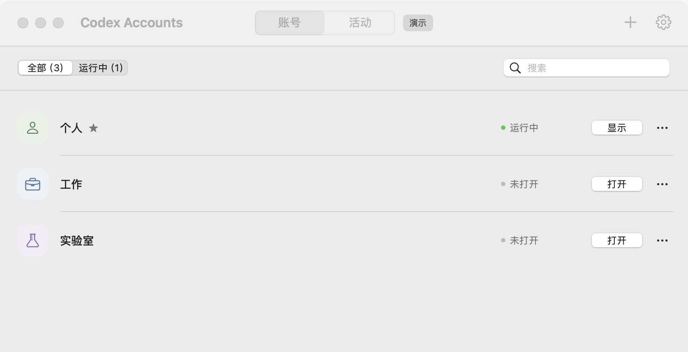
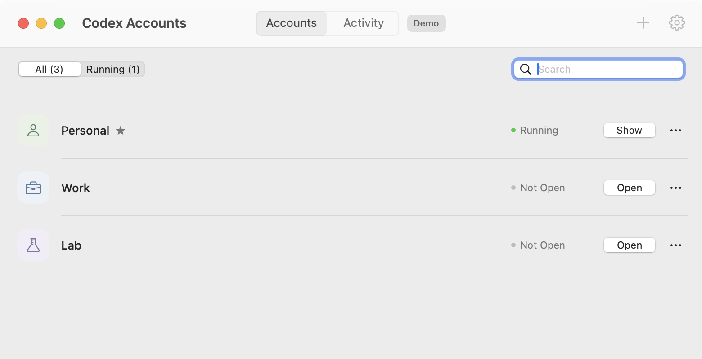
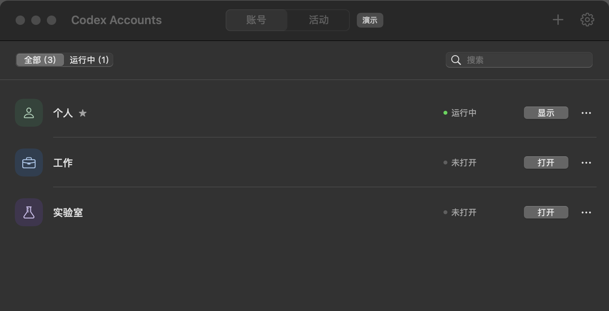

# 界面设计

目标是一个每天可以顺手打开的 macOS 小工具。以账号为主，不加入侧栏、仪表盘、营销信息或没有真实数据支持的用量图表。

主窗口默认 780 × 460 pt，最小 640 × 340 pt；列表在较小窗口和账号较多时滚动。标题栏采用原生工具栏，放置账号 / 活动、添加与设置。筛选和搜索位于列表上方。账号行将头像、名称、用户备注、窗口状态与打开按钮放在同一层，其他操作收进更多菜单。

背景、文字、表单、按钮和搜索框使用 macOS 系统样式；低饱和颜色只用于区分账号。状态同时使用文字与圆点，常用账号用星标表示。字体使用 macOS 系统字体，图标使用 SF Symbols。

界面随 macOS 语言偏好显示简体中文或英文。移除宣传标题、介绍段落、首次登录说明和底部说明；没有备注时，账号行不显示第二行文字。仅在空列表、失败提示和移除确认中显示必要信息。

添加 / 编辑弹窗只包含名称、可选备注、图标、颜色和常用标记。设置只保留桌面应用与本地数据；快捷键在系统菜单中显示。应用路径放到悬停提示里。空列表、搜索无结果、没有运行窗口、保存错误都有对应状态。

以上预览由原生 SwiftUI 窗口生成，使用明确标记的演示账号。真实运行模式从空列表开始。
